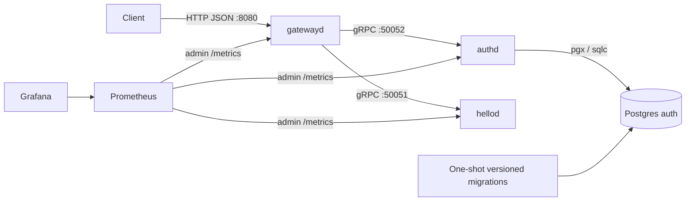

# Go microservices engineering portfolio

A Go service architecture experiment: an HTTP gateway translates Protobuf APIs to
gRPC, an authentication service stores users in Postgres, and a Hello service
provides a small authenticated endpoint. Shared platform code covers startup,
shutdown, health checks, configuration, logging, metrics, and tracing hooks.

This demonstrates service composition, generated API/data boundaries, and local
operational tooling. It is experimental software, with no production reliability
or scalability claim. See [the final review](FINAL_REVIEW.md) for
verified checks and unresolved risks, and [DESIGN.md](DESIGN.md) for design intent.

## Architecture



The gateway validates access JWTs on protected routes. Register, login, Validate,
and health routes are public. See [the authentication contract](SECURITY.md#http-authentication-contract). Internal gRPC transport is plaintext in this local setup.
Admin listeners expose `/livez`, `/readyz`, and `/metrics` separately from APIs.

## Local quickstart

Requires Docker Engine with Compose v2.24.4 or newer, Go 1.24.9 (the CI
toolchain), Bash, Make, curl, jq, openssl, and Python 3 for `make smoke-compose`. Checked-in generated code supports builds without
installing generators.

```bash
cp deployments/.env.example deployments/.env
# Write a new local signing secret (never commit deployments/.env):
printf 'AUTH_JWT_SECRET=%s\n' "$(openssl rand -hex 32)" > deployments/.env
make test
make up-prod
```

`prod` is a historical Compose profile name for a **local demo**, not a production
environment. It starts Postgres, applies migrations before auth starts, builds all
three services, and starts Prometheus/Grafana. Ports bind to localhost. Postgres
uses published development credentials; Grafana permits anonymous viewing.
Do not expose this stack to a network or reuse these credentials elsewhere.

```bash
curl --fail http://localhost:8081/readyz
export EMAIL=reviewer@example.com PASSWORD=local-demo-password
bash scripts/register.sh
bash scripts/login.sh
# Copy accessToken from the login response:
export ACCESS_TOKEN='<fresh accessToken>'
bash scripts/validate.sh
curl --fail -H "Authorization: Bearer $ACCESS_TOKEN" http://localhost:8080/v1/hello/reviewer
```

Gateway: http://localhost:8080; Prometheus: http://localhost:9090;
Grafana: http://localhost:3000. `make logs-prod` follows logs.
`make down-prod` **deletes local database and observability volumes**.
For database-only development use `make up`; it initializes the database but does
not apply migrations. See [local profile details](deployments/PRODUCTION_PROFILE.md)
and [migration policy](MIGRATIONS.md).

## Generation and verification

```bash
export PATH="$(go env GOPATH)/bin:$PATH"
make tools                 # pinned generators and staticcheck; needs network
make fmt-check
make lint-migrations
make proto-check           # compares with fetched origin/main
make generate              # regenerate Protobuf and SQL query code
make verify                # formatting + generation + tracked diff check
go vet ./...
staticcheck ./...
staticcheck -tags integration ./...
make test                  # unit tests with race detector
make test-integration      # disposable Postgres via testcontainers + race detector
make migrate-auth-smoke    # real migrate CLI + negative SQL/dirty-state tests
make smoke-compose         # actual Dockerfile builds + disposable full stack; needs Docker
```

`make fmt` formats tracked Go files. New Go files must be added to Git first.
CI installs pinned generators and compares Protobuf against the PR base SHA
(or the previous push SHA), rather than comparing a main-branch push to itself.
For manual checks use `make proto-breaking PROTO_BASE=<commit>`.
Generation requires access to the locked Google APIs dependency on buf.build.

## Limitations

- Authentication is a demonstration: refresh tokens are issued, but refresh,
  rotation, logout, and revocation endpoints are not implemented. Refresh tokens
  are rejected where access tokens are expected.
- Integration tests construct HTTP/gRPC servers with the real edge middleware.
  `make smoke-compose` additionally exercises command startup, actual container
  images, Prometheus scraping, Grafana provisioning, OTLP metrics, and Loki logs.
- No TLS termination, service identity, production secret manager, deployment
  automation, backup/restore validation, load testing, or production SLO evidence.
- Observability profiles, dashboards, alerts, and OTel configuration are examples;
  startup smoke coverage does not prove alert accuracy, SLOs, or performance.
  The logs profile mounts the Docker socket and reads this Compose project’s logs.

For source-based runs, export the same randomly generated `AUTH_JWT_SECRET` to
both authd and gatewayd; there is no signing-key fallback, even in dev. Staging
and prod also require an explicit `AUTH_DB_DSN`. See [SECURITY.md](SECURITY.md) for
historical-key rotation actions and the trust boundary of direct gRPC access.

## License

Copyright © 2026 Tyler Petri. All rights reserved; see [LICENSE.txt](LICENSE.txt).
Public visibility does not grant an open-source license. The existing license
restricts use and distribution and calls the work confidential. The owner has
confirmed public-display rights while retaining all rights reserved.
Clarifying the confidentiality wording remains recommended; this preparation
does not change licensing rights. Dependency and container obligations are
reviewed separately in [THIRD_PARTY_REVIEW.md](THIRD_PARTY_REVIEW.md).
